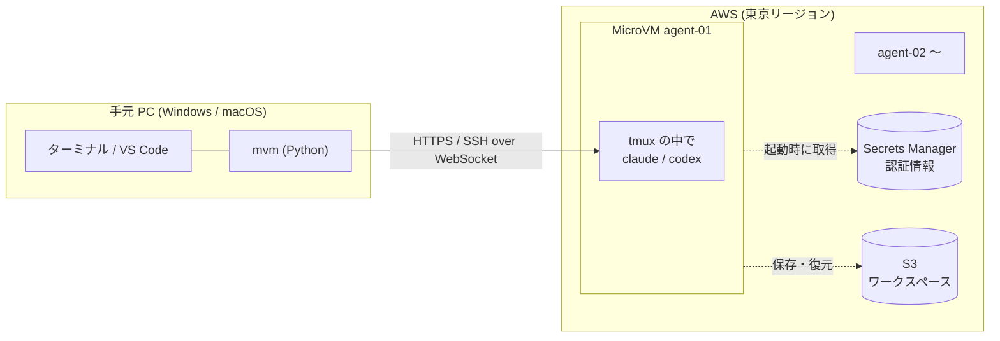

# parallel-microvms-agents

Claude Code / Codex を **AWS Lambda MicroVMs** の上で何台も並べて動かし、手元の PC (Windows / macOS) では画面の確認と指示だけを行うためのツール一式です。
エージェント本体と、エージェントが走らせるビルド・テスト・ブラウザはすべて MicroVM の中で動くので、手元の CPU とメモリをほとんど使いません。



## できること

- **並列に動かす**: `mvm fleet 3 --prompts-file tasks.txt` で、1 台に 1 つずつタスクを渡して起動する。台ごとに作業ブランチ (`pmva/<名前>`) が分かれる
- **手元から様子を見る・指示する**: `mvm peek` (画面の末尾)、`mvm wait` (応答が終わるまで待つ)、`mvm result` (最後の応答)、`mvm follow` (推論の過程)、`mvm send` (指示を送る)、`mvm ssh` (画面に入って操作する)、VS Code の Remote-SSH
- **PC を閉じても続ける**: 作業中の VM は AWS 側のキープアライブが起こし続け、作業が終わればしばらくして一時停止する
- **8 時間の寿命を越える**: ワークスペースを S3 に保存し、`mvm renew` で新しい VM に移る
- **手元のエージェントを司令塔にする**: 手元の Claude Code / Codex に skill を入れ、タスクの分割・起動・結果の確認を任せる ([docs/orchestrator.md](docs/orchestrator.md))
- **認証方式を選べる**: Claude のサブスクリプション、API キー、Amazon Bedrock、Claude Platform on AWS、ChatGPT アカウント、社内の LLM ゲートウェイなど ([docs/auth.md](docs/auth.md))
- **費用を抑える**: 毎晩の自動停止、予算アラート、`mvm cost` での試算と実績の確認 ([docs/cost.md](docs/cost.md))

手元に要るのは Python 3.9 以上、AWS CLI v2、OpenSSH クライアント、Git だけです (WSL は不要)。

## はじめかた

**[docs/quickstart.md](docs/quickstart.md) を上から順に進めてください。** AWS アカウントの守り方から、1 台目のエージェントを動かして止めるまでを 9 つの手順にまとめています。流れは次のとおりです。

```bash
mvm doctor                        # 前提ツールと AWS の認証を確認
mvm infra deploy                  # (管理者で 1 回だけ) S3・IAM ロールなどを作る
mvm secret set claude-oauth-token # エージェントの認証情報を登録
mvm image build                   # Claude Code / Codex 入りのイメージを作る
mvm up test-01 --repo https://github.com/<owner>/<repo>.git --prompt "README を読んで概要を説明して"
mvm peek test-01                  # 画面を確認
mvm stop test-01                  # 保存してから止める
```

`infra deploy` だけを管理者で行い、普段は権限を絞った IAM ユーザーで使います。AI エージェントに AWS を使わせるので、ルートユーザーの MFA と予算アラートを最初に設定してください (quickstart の手順 1)。

費用の目安は、4GB の MicroVM 1 台で 1 時間あたり約 $0.29 (税抜) です。止めている間は計算料金がかかりません ([docs/cost.md](docs/cost.md))。

## ドキュメント

**使う人向け**

| 読みたいこと | ページ |
|---|---|
| はじめて使う (1 台目を動かすまで) | [quickstart.md](docs/quickstart.md) |
| 実際の作業での使い方 (並列実行、PC を閉じて任せる、8 時間を超える、通知、VS Code) | [usage.md](docs/usage.md) |
| 手元の Claude Code / Codex を司令塔にする | [orchestrator.md](docs/orchestrator.md) |
| 構築と管理 (AWS の構成、操作用の IAM ユーザー、イメージの更新、片付け) | [setup.md](docs/setup.md) |
| 認証方式ごとの設定 | [auth.md](docs/auth.md) |
| コマンドとオプション | [commands.md](docs/commands.md) |
| `config.env` の全項目 | [config.md](docs/config.md) |
| 費用 | [cost.md](docs/cost.md) |
| うまくいかないとき | [troubleshooting.md](docs/troubleshooting.md) |
| よくある質問 | [faq.md](docs/faq.md) |
| 変更履歴 | [CHANGELOG.md](CHANGELOG.md) |

**このリポジトリを変更する人向け**

| 読みたいこと | ページ |
|---|---|
| 構成、テスト、CI、リリース | [development.md](docs/development.md) (コーディングエージェント向けのルールは [AGENTS.md](AGENTS.md)) |
| 設計と判断の理由 | [architecture.md](docs/architecture.md) |
| 実機での検証の記録 | [poc-checklist.md](docs/poc-checklist.md) |

## 注意点

- Lambda MicroVMs は 2026 年 6 月に提供が始まったサービスです。東京リージョンの実機で主な機能を確かめていますが、未確認の項目もあります ([poc-checklist.md](docs/poc-checklist.md))
- 同時に動かせる台数は、AWS アカウントの MicroVM メモリのクォータで決まります。8GB なら 4GB の VM が 2 台です。`mvm doctor` で確認できます
- MicroVM の寿命は最大 8 時間です。成果物は git に push するか、`mvm save` で S3 に残してください
- VM の中のエージェントは sudo を使えません。OS のパッケージは `IMAGE_EXTRA_PACKAGES` でイメージに入れます
- 料金は変わることがあります。AWS の料金ページで最新の単価を確認してください

## ライセンス

[MIT License](LICENSE)
