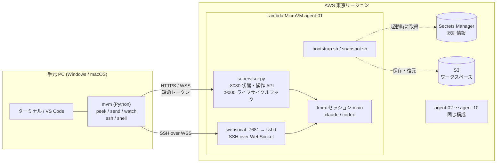

# parallel-microvms-agents

Claude Code / Codex を **AWS Lambda MicroVMs** 上で最大 10 本並列に動かし、手元の PC は「画面を見る・指示を出す」だけにするための資材一式です。
ビルド・テスト・エージェント本体はすべてクラウド側の MicroVM で実行されるので、手元 PC の CPU 使用率と発熱を抑えられます。



## できること

| 要件 | 実現方法 |
|---|---|
| 最大 10 エージェントの並列実行 | `mvm fleet 10` / `mvm up <name>`。`MAX_AGENTS=10` で上限を制御 |
| 手元 PC から画面確認 | `mvm peek`（画面末尾を取得）、`mvm watch`（全台を一覧表示）、`mvm ssh`（tmux にアタッチ） |
| 手元 PC から指示 | `mvm send <name> "指示"`（接続せずに入力）、または `mvm ssh` で直接操作 |
| 多様な認証方式 | Claude Code: サブスクリプション (OAuth トークン) / API キー / Amazon Bedrock / LLM ゲートウェイ / 対話ログイン<br>Codex: API キー / ChatGPT ログイン (auth.json) / 対話ログイン |
| 8 時間制限への対応 | ワークスペースを S3 に定期保存し、`mvm renew` で新しい MicroVM に復元 |
| PC を閉じても作業を続ける | AWS 側のキープアライブが、作業中の VM だけを一時停止させない（作業が終われば止まる） |
| 止め忘れ防止 | 毎晩決まった時刻に全台を保存してから終了（`NIGHTLY_STOP_TIME=23:00`） |
| 完了・入力待ちの通知 | Claude Code の hooks / Codex の notify から Slack などの Webhook に通知（`mvm up --notify`） |
| コスト試算と予算アラート | `mvm cost`（[docs/cost.md](docs/cost.md)）、`mvm cost --actual`（Cost Explorer の実績）、AWS Budgets のメール通知（任意） |
| エージェントの版管理 | Claude Code / Codex の版をイメージで固定し、`mvm image update-versions` で更新 |
| 認証情報の分離 | 起動するエージェントの認証情報だけを読める実行ロールを自動で選ぶ |
| 手元 PC は Windows / macOS 両対応 | 手元 CLI は Python 標準ライブラリのみで実装。必要なのは Python 3.9 以上、AWS CLI v2、OpenSSH クライアント (両 OS に標準搭載) だけ |

## クイックスタート

**初めての人は [docs/quickstart.md](docs/quickstart.md) を上から順に進めてください。** AWS アカウントの守り方から 1 台目のエージェントを動かして止めるまでを、Windows / macOS の両方について 9 つの手順にまとめています。
以下は流れの要約です。

手元 PC に Python 3.9 以上と AWS CLI v2 を入れてから始めます ([docs/setup.md](docs/setup.md#0-手元-pc-の準備-windows--macos))。

インストールスクリプトが前提ツールの確認、`config.env` の作成、`mvm` エイリアスの登録を行います (新しいターミナルを開くと `mvm` で呼べます)。

```powershell
# Windows (PowerShell)
powershell -ExecutionPolicy Bypass -File scripts\install.ps1
```

```bash
# macOS
scripts/install.sh
```

ここから先は両 OS 共通です。`infra deploy` だけを管理者で行い、その後は `pmva-operator` ポリシーだけを付けた IAM ユーザーに切り替えます ([手順](docs/quickstart.md#5-普段使う-iam-ユーザーに切り替える))。

```bash
mvm doctor                        # 前提ツール・AWS 認証・リージョン対応を確認
mvm infra deploy                  # (管理者で) S3 / IAM ロール / ログを作成
claude setup-token                # (サブスクリプションの場合) 長期トークンを発行
mvm secret set claude-oauth-token # 発行したトークンを Secrets Manager に登録
mvm secret set github-token       # clone / push 用の GitHub トークン
mvm image build                   # Claude Code / Codex 入りのイメージをビルド
mvm up test-01 --repo https://github.com/<owner>/<repo>.git --prompt "README を読んで概要を説明して"
mvm peek test-01                  # 画面を確認
mvm ssh test-01                   # tmux にアタッチして直接操作 (Ctrl-b d で切断)
```

詳しい手順は [docs/setup.md](docs/setup.md) を参照してください。

## ドキュメント

| 読みたいこと | ページ |
|---|---|
| はじめて使う (1 台目を動かすまで) | [docs/quickstart.md](docs/quickstart.md) |
| 実際の作業での使い方 (並列実行、PC を閉じて任せる、8 時間を超える、費用を抑える) | [docs/usage.md](docs/usage.md) |
| コマンドとオプションの一覧 | [docs/commands.md](docs/commands.md) |
| `config.env` の全項目と反映のタイミング | [docs/config.md](docs/config.md) |
| 認証方式ごとの設定 (サブスクリプション、API キー、Bedrock、ChatGPT、GitHub) | [docs/auth.md](docs/auth.md) |
| 構築手順の詳細、日々の運用、トラブルシューティング | [docs/setup.md](docs/setup.md) |
| よくある質問 | [docs/faq.md](docs/faq.md) |
| 費用の試算 | [docs/cost.md](docs/cost.md) |
| 設計と判断の理由 | [docs/architecture.md](docs/architecture.md) |
| 実機での検証結果 | [docs/poc-checklist.md](docs/poc-checklist.md) |
| このリポジトリを変更する (テスト、CI、注意点) | [docs/development.md](docs/development.md) |

## ディレクトリ構成

```
bin/mvm.py                  ローカル操作 CLI 本体 (Python 標準ライブラリのみ。Windows / macOS / Linux 共通)
bin/mvm                     macOS / Linux 用の起動スクリプト
bin/mvm.cmd                 Windows 用の起動スクリプト (PowerShell / コマンドプロンプト)
config.example.env          設定テンプレート
infra/cloudformation.yaml   S3、ビルドロール、実行ロール、ログ、操作用 IAM ポリシー
image/                      MicroVM イメージ (zip 化して CreateMicrovmImage に渡す)
  Dockerfile                AL2023 + Node.js + Claude Code + Codex + tmux + sshd + websocat
  supervisor.py             ライフサイクルフック (:9000) と状態/操作 API (:8080)
  bootstrap.sh              /run 後の初期化 (認証・clone・tmux 起動)
  snapshot.sh               ワークスペースの S3 保存
scripts/estimate_cost.py    コスト試算
scripts/install.sh          macOS / Linux 用のセットアップ (前提確認・config.env・エイリアス)
scripts/install.ps1         Windows 用のセットアップ
tests/                      自動テスト (python -m unittest discover -s tests)
.github/workflows/ci.yml    Windows / macOS / Linux でテストと lint を実行する CI
.github/workflows/agent-versions.yml  Claude Code / Codex の新しい版を毎週確認し、Issue で知らせる
docs/
  quickstart.md             はじめての人向けの最短手順
  usage.md                  場面別の使い方
  commands.md               コマンドリファレンス
  config.md                 設定リファレンス (config.env)
  auth.md                   認証方式ごとの設定方法
  setup.md                  構築手順と日々の運用
  faq.md                    よくある質問
  cost.md                   コスト試算
  architecture.md           設計と判断理由
  poc-checklist.md          実機での検証結果と、最初に検証すべき項目
  development.md            開発者向けガイド
```

## AWS アカウントの安全対策

AI エージェントや自動化ツールに AWS を操作させるので、アカウントの守りを先に固めてください。

| やること | 方法 |
|---|---|
| ルートユーザーを守る | パスワードを他で使わないものにし、MFA を設定する。普段は使わず、アクセスキーも作らない |
| 普段は権限を絞ったユーザーで使う | `pmva-operator` ポリシーだけを付けた IAM ユーザーで `mvm` を使う ([手順](docs/setup.md#操作用の-iam-ユーザー))。`mvm infra deploy` だけを管理者 (できれば SSO の一時的な認証情報) で、自分の PC から実行する |
| 管理者のキーを渡さない | クラウドの開発環境・CI・他人の PC には `pmva-operator` のキーだけを渡す。PoC では管理者のキーを渡したことで、AWS の不正利用検知によりアカウントが制限された |
| キーを定期的に作り直す | 90 日を目安に作り直し、古いキーを削除する。`mvm doctor` が管理者権限・ルート・古いキーを警告する |
| 費用の異常に早く気付く | 予算アラート (`BUDGET_MONTHLY_USD` / `BUDGET_EMAIL`) を設定し、`mvm cost --actual` で実績を確認する |
| 不審な操作を確認できるようにする | CloudTrail の証跡を有効にしておく。AWS から不正アクセスの可能性を知らせるメールが来たら、メールの手順に従い、使っていたキーを無効化・削除してからサポートに返信する |
| 認証情報を漏らさない | トークンやキーはチャットやリポジトリに貼らず、`mvm secret set` で Secrets Manager に登録する (`config.env` と `.state/` は `.gitignore` 済み) |

## 現状と注意点

- Lambda MicroVMs は 2026 年 6 月に提供開始されたサービスです。2026-10-28 に東京リージョンの実際の AWS アカウントで、1 台での PoC (イメージのビルド、起動、peek / send、SSH / シェル接続、サスペンドと自動レジューム、保存と復元、Bedrock 認証の経路) を実施しました。結果と未確認の項目は [docs/poc-checklist.md](docs/poc-checklist.md) にまとめています。
- **10 台並列にはクォータの引き上げが必要です**。PoC のアカウントでは `Max allocated ARM_64 MicroVM memory` が 8GB で、4GB の VM は同時に 2 台までしか起動できませんでした。40GB 以上への引き上げを AWS サポートに申請してください。
- PoC の途中 (2026-10-29 03:13 UTC ごろ) から、PoC のアカウントが AWS の不正利用検知で制限されました (Lambda 関数の API の拒否、メモリのクォータ 0GB)。管理者の長期アクセスキーをクラウドの開発環境から使ったことがきっかけとみられます。下の「AWS アカウントの安全対策」を守ってください。詳しくは [docs/poc-checklist.md](docs/poc-checklist.md) の G を参照してください。
- VM 内のエージェント (`agent` ユーザー) は sudo を使えません (コンテナに no_new_privs が付いているため)。root が必要な作業は `mvm shell` (root で入る) で行うか、必要なパッケージを `image/Dockerfile` に追加してください。
- 手元 CLI は GitHub Actions で Windows / macOS / Linux それぞれについて自動テストしています (AWS CLI はスタブ、MicroVM 側はローカルのテストサーバーで代用)。端末の表示や VS Code など、目で見て確かめる項目は [docs/poc-checklist.md](docs/poc-checklist.md) の「C2」に残っています。
- MicroVM の寿命は最大 8 時間です。成果物は git に push するか、`mvm save` / 定期スナップショットで S3 に残してください。
- 料金単価はローンチ時に報告された値で試算しています。必ず AWS の料金ページで最新の単価を確認してください。
