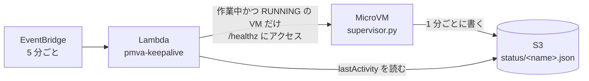

# アーキテクチャと設計判断

## 目的

複数の Claude Code / Codex を手元 PC で同時に動かすと、エージェントが走らせるビルド・テスト・言語サーバーで CPU とメモリが埋まり、PC が発熱します。
この構成では**エージェントとその子プロセスをすべて Lambda MicroVMs に移し**、手元 PC には次の処理だけを残します。

- AWS API の呼び出し（起動・停止・トークン発行）
- 画面の取得 (`peek` / `watch`) と指示の送信 (`send`)
- 必要なときだけの対話接続 (`ssh` / `shell`)。手元の負荷は ssh クライアントとターミナルの描画だけです

### 手元 PC は Windows / macOS の両方に対応

| 方針 | 理由 |
|---|---|
| 手元 CLI (`bin/mvm.py`) は Python の標準ライブラリだけで書く | Windows / macOS とも Python と AWS CLI を入れるだけで動く。bash や WSL に依存しない |
| WebSocket クライアントを `mvm` に内蔵する | websocat などの追加ツールが要らない。`HTTPS_PROXY` (CONNECT) にも対応する |
| AWS の操作は AWS CLI v2 を呼び出す | SSO やプロファイルなど、手元で設定済みの AWS 認証をそのまま使える |
| SSH は各 OS 標準の OpenSSH クライアントを使う | Windows 10/11 と macOS に標準で入っている。VS Code Remote-SSH とも共通 |
| 起動スクリプトを OS ごとに用意 (`bin/mvm`、`bin\mvm.cmd`) | 本体は共通で、呼び出し方だけが違う |
| VM 内のスクリプトは改行を LF に固定 (`.gitattributes`、zip 化時にも変換) | Windows で clone しても MicroVM 内の bash が壊れない |

## Lambda MicroVMs の主な仕様

| 項目 | 内容 |
|---|---|
| 隔離 | 1 MicroVM = 1 Firecracker VM。中でコンテナとしてアプリが動く |
| アーキテクチャ | ARM64 のみ (Amazon Linux 2023 ベース) |
| サイズ | イメージ作成時に `minimumMemoryInMiB` で指定。2GB あたり 1 vCPU (最大 8GB / 4 vCPU)。ピーク時は最大 4 倍 (16 vCPU / 32GB) までバースト |
| 寿命 | `maximumDurationInSeconds` 最大 28,800 秒 (8 時間)。サスペンド中も寿命に含まれる |
| 起動 | ビルド時のメモリ・ディスクのスナップショットから復元するので数秒で起動 |
| アイドル | `idlePolicy` で、エンドポイントへの**受信**通信が一定時間ないと自動サスペンド。通信が来ると自動レジューム |
| 受信 | VM ごとの HTTPS エンドポイント。IAM で発行する最大 60 分のトークンが必要。既定はポート 8080、ヘッダや WebSocket サブプロトコルでポートを指定 |
| シェル | `SHELL_INGRESS` コネクタを付けると、AWS コンソールの Connect か WebSocket でシェルに入れる |
| 送信 | 既定でインターネットに出られる。VPC 内リソースへは `VPC_EGRESS` コネクタ |
| 認証情報 | 実行ロールの一時認証情報が IMDSv2 経由で VM 内に渡る |

## 設計判断

### 1 エージェント = 1 MicroVM

1 台の大きな VM に 10 エージェントを詰めることもできますが、次の理由で 1 対 1 にしています。

- **障害とリソースの分離**: あるエージェントのビルドが CPU を使い切っても他に影響しない
- **寿命を個別に管理できる**: 8 時間制限、サスペンド、`renew` をセッション単位で扱える
- **サイズの上限**: 1 VM のベースラインは最大 4 vCPU / 8GB なので、10 本を 1 台に載せると足りない
- **費用はほぼ同じ**: vCPU とメモリの時間課金なので、台数を分けても合計は変わらない

### 接続方法の選択肢

| 方法 | 手元の負荷 | 用途 | 仕組み |
|---|---|---|---|
| `mvm peek` / `watch` / `send` | ごく小さい (定期的な HTTPS) | 進捗確認、短い指示 | VM 内 `supervisor.py` の `:8080` API が `tmux capture-pane` / `send-keys` を実行 |
| `mvm ssh` | 小さい (ssh + mvm の中継) | 対話操作、VS Code Remote-SSH、scp、ポート転送 | ssh の ProxyCommand で `mvm _ssh-proxy` (内蔵 WebSocket クライアント) が WSS (`:7681`) に接続し、VM 内の websocat → sshd (127.0.0.1:2222) につなぐ |
| `mvm shell` / コンソールの Connect | 小さい | SSH が使えないときの予備、障害調査 | AWS 標準の `SHELL_INGRESS` (`:8022`) |

ブラウザからは任意のヘッダを付けられないため、Web ターミナル (ttyd など) は採用していません。AWS コンソールの Connect ボタンがブラウザ用の手段になります。

### エージェントは tmux の中で動かす

- 接続が切れてもエージェントは動き続ける (`ssh` を閉じても作業は継続)
- `peek` / `send` は tmux を介して画面取得・入力をするので、エージェント側の改造が不要
- ウィンドウ構成: `shell` (作業用シェル)、`claude` / `codex` (エージェント)。エージェントはシェル上で起動するので、終了してもウィンドウは残る

### 認証情報はイメージに入れない

MicroVM はビルド時のスナップショットを全台で共有します。そのため、

- API キーやトークンは **Secrets Manager** に置き、`/run` フック後に `bootstrap.sh` が実行ロールの権限で取得する
- SSH ホスト鍵も `/run` 後に VM ごとに生成する
- `runHookPayload` (最大 4KB) にはシークレットの**名前**だけを入れ、値は入れない

### アイドルとサスペンド

アイドル判定は**エンドポイントへの受信通信**だけを見ます。エージェントが外向きに API を呼んで作業していても、誰も接続していなければアイドル扱いになります。

| 状況 | 動作 |
|---|---|
| `mvm ssh` で接続中 | ServerAlive (30 秒ごと) の通信があるのでサスペンドされない (PoC で確認) |
| `mvm watch` を実行中 | 定期的な `/status` 取得でサスペンドされない |
| 何も接続していないが、エージェントが作業中 | キープアライブ (下記) が `/healthz` を送るのでサスペンドされない |
| 何も接続しておらず、作業もしていない | `IDLE_MAX_SECONDS` (既定 30 分) 後にサスペンド。メモリごと保存され、次の通信で再開する。外向き通信は再開時に切断されるので、エージェントは API 呼び出しをリトライする |
| 無人で長時間走らせたい | キープアライブで足りる。確実に止めたくなければ `mvm up --idle off` (8 時間で終了) |

### キープアライブ (作業中の VM だけを起こし続ける)

アイドル判定は受信通信しか見ないので、「作業中かどうか」を外から調べるためにエンドポイントへアクセスすると、それ自体がアイドルのタイマーを戻してしまいます。そこで向きを逆にして、VM が自分の状態を外 (S3) に書き出し、AWS 側の Lambda は S3 だけを見て判断します。

`/healthz` への受信通信で、その VM のアイドルのタイマーが戻ります。

- 作業中の判定: tmux の画面が変わった、または tmux 内のプロセスが 30 秒で 1 秒以上 CPU を使った
- 一時停止中・終了済みの VM は状態が更新されない (`updatedAt` が古い) ので、Lambda は触らない (起こさない)
- Lambda は MicroVMs の REST API を自前で署名して呼ぶ。Lambda の実行環境の boto3 が新しいサービスに対応しているかに左右されないため

### 通知

Claude Code の hooks (`Stop`、`Notification`) と Codex の `notify` から `image/notify.sh` を呼び、Webhook に 1 行の通知を送ります。Webhook の URL は他の認証情報と同じく Secrets Manager に置きます。

### 永続化

- MicroVM のディスクは一時領域で、終了すると消えます。
- `snapshot.sh` が `~/work` (リポジトリ)、`~/.claude`、`~/.codex` (会話履歴) を tar.gz にして S3 に保存します。認証情報ファイルは除外します。
  - 定期保存: `SNAPSHOT_INTERVAL_SECONDS` (既定 30 分)
  - 手動保存: `mvm save`。`mvm stop` も既定で終了前に保存
  - 終了直前: terminate フック (最大 60 秒) で可能な範囲で保存
- `mvm renew` / `mvm up --restore latest` で新しい VM に復元します。
- 基本は **git に push すること**です。作業ブランチは `pmva/<name>`。上流は base ブランチにせず、`push.autoSetupRemote` で同名ブランチに push されます。

### セキュリティ

- 受信はすべて IAM で発行した短命トークンが必要 (アプリ用は最大 60 分、シェル用は 15 分で発行)
- SSH は TLS (AWS のエンドポイント) の内側を通るため、ホスト鍵の検証は省略している (`StrictHostKeyChecking no`)。鍵認証のみ
- 実行ロールは使うエージェントの組み合わせごとに 4 つあり、`mvm up` が自動で選ぶ。VM 内のエージェント (やエージェントが実行したコード) が読めるのは、そのセッションで使うエージェントの認証情報だけ

  | 起動するエージェント | 実行ロール | 読めるシークレット (`${PMVA_PREFIX}/` の後ろ) |
  |---|---|---|
  | Claude Code だけ | `ExecutionRoleClaude` | `anthropic-*`、`claude-*`、`github-*`、`notify-*` (+ Bedrock の呼び出し) |
  | Codex だけ | `ExecutionRoleCodex` | `openai-*`、`codex-*`、`github-*`、`notify-*` |
  | 両方 | `ExecutionRole` | 上の全部 |
  | どちらも使わない (`--agent none`) | `ExecutionRoleNone` | `github-*`、`notify-*` |

  そのため `--claude-secret` などで指定するシークレット名もこの接頭辞で始める必要がある (`mvm up` が起動前に確認する)。IAM のポリシーシミュレーターで 4 つのロールが上の表どおりに許可・拒否することを確認済み
- S3 は全ロール共通で、`workspaces/`・`workspace-history/`・`status/` 配下を読み書きできる。つまり他のセッションのワークスペーススナップショットは読めてしまう。1 人で使う前提の設計。信頼できないリポジトリを扱う場合や複数人で使う場合は、プレフィックス (= スタック) を分ける
- VM 内の `agent` ユーザーは sudo を使えない (コンテナに no_new_privs が付いているため。PoC で確認)。root が必要な作業は `mvm shell` (root で入る) で行うか、必要なパッケージをイメージに追加する
- 機密性の高いリポジトリを扱う場合は、VPC egress コネクタと NAT / プロキシで送信先を制限することを検討する
