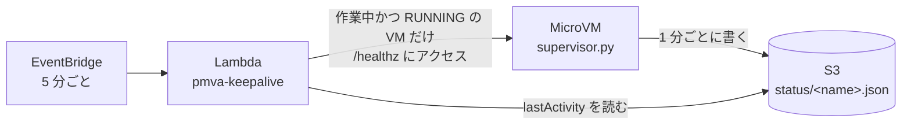

# アーキテクチャと設計判断

## 目的

複数の Claude Code / Codex を手元 PC で同時に動かすと、エージェントが走らせるビルド・テスト・言語サーバーで CPU とメモリが埋まり、PC が発熱します。
この構成では**エージェントとその子プロセスをすべて Lambda MicroVMs に移し**、手元 PC には次の処理だけを残します。

- AWS API の呼び出し（起動・停止・トークン発行）
- 画面の取得 (`peek` / `watch`) と指示の送信 (`send`)
- 必要なときだけの対話接続 (`ssh` / `shell`)。手元の負荷は ssh クライアントとターミナルの描画だけです

### 手元 PC は Windows / macOS の両方に対応

| 方針 | 理由 |
|---|---|
| 手元 CLI (`bin/mvm.py`) は Python の標準ライブラリだけで書く | Windows / macOS とも Python と AWS CLI を入れるだけで動く。bash や WSL に依存しない |
| WebSocket クライアントを `mvm` に内蔵する | websocat などの追加ツールが要らない。`HTTPS_PROXY` (CONNECT) にも対応する |
| AWS の操作は AWS CLI v2 を呼び出す | SSO やプロファイルなど、手元で設定済みの AWS 認証をそのまま使える |
| SSH は各 OS 標準の OpenSSH クライアントを使う | Windows 10/11 と macOS に標準で入っている。VS Code Remote-SSH とも共通 |
| 起動スクリプトを OS ごとに用意 (`bin/mvm`、`bin\mvm.cmd`) | 本体は共通で、呼び出し方だけが違う |
| VM 内のスクリプトは改行を LF に固定 (`.gitattributes`、zip 化時にも変換) | Windows で clone しても MicroVM 内の bash が壊れない |

## Lambda MicroVMs の主な仕様

| 項目 | 内容 |
|---|---|
| 隔離 | 1 MicroVM = 1 Firecracker VM。中でコンテナとしてアプリが動く |
| アーキテクチャ | ARM64 のみ (Amazon Linux 2023 ベース) |
| サイズ | イメージ作成時に `minimumMemoryInMiB` で指定。2GB あたり 1 vCPU (最大 8GB / 4 vCPU)。ピーク時は最大 4 倍 (16 vCPU / 32GB) までバースト |
| 寿命 | `maximumDurationInSeconds` 最大 28,800 秒 (8 時間)。サスペンド中も寿命に含まれる |
| 起動 | ビルド時のメモリ・ディスクのスナップショットから復元するので数秒で起動 |
| アイドル | `idlePolicy` で、エンドポイントへの**受信**通信が一定時間ないと自動サスペンド。通信が来ると自動レジューム |
| 受信 | VM ごとの HTTPS エンドポイント。IAM で発行する最大 60 分のトークンが必要。既定はポート 8080、ヘッダや WebSocket サブプロトコルでポートを指定 |
| シェル | `SHELL_INGRESS` コネクタを付けると、AWS コンソールの Connect か WebSocket でシェルに入れる |
| 送信 | 既定でインターネットに出られる。VPC 内リソースへは `VPC_EGRESS` コネクタ |
| 認証情報 | 実行ロールの一時認証情報が IMDSv2 経由で VM 内に渡る |

## 設計判断

### 1 エージェント = 1 MicroVM

1 台の大きな VM に複数のエージェントを詰めることもできますが、次の理由で 1 対 1 にしています。

- **障害とリソースの分離**: あるエージェントのビルドが CPU を使い切っても他に影響しない
- **寿命を個別に管理できる**: 8 時間制限、サスペンド、`renew` をセッション単位で扱える
- **サイズの上限**: 1 VM のベースラインは最大 4 vCPU / 8GB なので、重い作業のエージェントを何本も載せると足りない
- **費用はほぼ同じ**: vCPU とメモリの時間課金なので、台数を分けても合計は変わらない

### 接続方法の選択肢

| 方法 | 手元の負荷 | 用途 | 仕組み |
|---|---|---|---|
| `mvm peek` / `watch` / `send` / `wait` / `result` / `follow` / `top` | ごく小さい (定期的な HTTPS) | 進捗確認、短い指示、終わるまで待つ、最後の応答を読む、推論の過程を見る、メモリを見る | VM 内 `supervisor.py` の `:8080` API が `tmux capture-pane` / `send-keys` を実行し、エージェントの状態、最後の応答、会話の記録、メモリの使用量を返す |
| `mvm view` | 小さい (ssh + mvm の中継) | エージェントの画面をそのまま見る (読み取り専用) | `mvm ssh` と同じ経路で、`agent-attach --view` が tmux の別セッション (同じウィンドウ群を共有) に読み取り専用で接続する |
| `mvm ssh` | 小さい (ssh + mvm の中継) | 対話操作、VS Code Remote-SSH、scp、ポート転送 | ssh の ProxyCommand で `mvm _ssh-proxy` (内蔵 WebSocket クライアント) が WSS (`:7681`) に接続し、VM 内の websocat → sshd (127.0.0.1:2222) につなぐ |
| `mvm shell` / コンソールの Connect | 小さい | SSH が使えないときの予備、障害調査 | AWS 標準の `SHELL_INGRESS` (`:8022`) |

ブラウザからは任意のヘッダを付けられないため、Web ターミナル (ttyd など) は採用していません。AWS コンソールの Connect ボタンがブラウザ用の手段になります。

### エージェントは tmux の中で動かす

- 接続が切れてもエージェントは動き続ける (`ssh` を閉じても作業は継続)
- `peek` / `send` は tmux を介して画面取得・入力をするので、エージェント側の改造が不要
- ウィンドウ構成: `shell` (作業用シェル)、`claude` / `codex` (エージェント)。エージェントはシェル上で起動するので、終了してもウィンドウは残る

### 認証情報はイメージに入れない

MicroVM はビルド時のスナップショットを全台で共有します。そのため、

- API キーやトークンは **Secrets Manager** に置き、`/run` フック後に `bootstrap.sh` が実行ロールの権限で取得する
- SSH ホスト鍵も `/run` 後に VM ごとに生成する
- `runHookPayload` (最大 4KB) にはシークレットの**名前**だけを入れ、値は入れない

### アイドルとサスペンド

アイドル判定は**エンドポイントへの受信通信**だけを見ます。エージェントが外向きに API を呼んで作業していても、誰も接続していなければアイドル扱いになります。

| 状況 | 動作 |
|---|---|
| `mvm ssh` で接続中 | ServerAlive (30 秒ごと) の通信があるのでサスペンドされない (PoC で確認) |
| `mvm watch` / `mvm wait` / `mvm follow` を実行中 | 定期的な `/status` や `/events` の取得でサスペンドされない (`wait` は、終わった台には取得をやめる) |
| 何も接続していないが、エージェントが作業中 | キープアライブ (下記) が `/healthz` を送るのでサスペンドされない |
| 何も接続しておらず、作業もしていない | `IDLE_MAX_SECONDS` (既定 30 分) 後にサスペンド。メモリごと保存され、次の通信で再開する。外向き通信は再開時に切断されるので、エージェントは API 呼び出しをリトライする |
| 無人で長時間走らせたい | キープアライブで足りる。確実に止めたくなければ `mvm up --idle off` (8 時間で終了) |

### キープアライブ (作業中の VM だけを起こし続ける)

アイドル判定は受信通信しか見ないので、「作業中かどうか」を外から調べるためにエンドポイントへアクセスすると、それ自体がアイドルのタイマーを戻してしまいます。そこで向きを逆にして、VM が自分の状態を外 (S3) に書き出し、AWS 側の Lambda は S3 だけを見て判断します。

`/healthz` への受信通信で、その VM のアイドルのタイマーが戻ります。

- 作業中の判定: tmux の画面が変わった、または tmux 内のプロセスが 30 秒で 1 秒以上 CPU を使った
- 一時停止中・終了済みの VM は状態が更新されない (`updatedAt` が古い) ので、Lambda は触らない (起こさない)
- Lambda は MicroVMs の REST API を自前で署名して呼ぶ。Lambda の実行環境の boto3 が新しいサービスに対応しているかに左右されないため

### エージェントの状態と通知

Claude Code の hooks と Codex の `notify` から `image/notify.sh` を呼び、エージェントの状態を `~/.pmva/agents/<claude|codex>.json` に記録します。`supervisor.py` の `/status` がそれを返し、`mvm wait` / `peek` が使います。

| きっかけ | 状態 |
|---|---|
| `bootstrap.sh` がエージェントを起動した | 最初の指示があれば `working`、なければ `ready` |
| `mvm send` で指示を送った (`/send`) / Claude Code の `UserPromptSubmit`、`PostToolUse` | `working` |
| Claude Code の `Stop` / Codex の `agent-turn-complete` | `done` (最後の応答の文章も記録し、`/result` で返す) |
| Claude Code の `StopFailure` (認証の失敗、利用上限など API のエラーで応答が終わった) | `error` (エラーの種類 `error` とエラーの文章も記録する) |
| Claude Code の `Notification` (許可・入力待ち) | `waiting`。応答の後にしばらく入力がないときの通知 (`idle_prompt`) では `done` / `error` のまま |
| tmux のウィンドウがシェルに戻った (`/status` を返すときに調べる) | `exited` |

フックは通知の設定にかかわらず常に入れます。利用者が `~/.claude/settings.json` に書いたフックは残し、pmva のものだけを入れ直します。スナップショットの復元で設定が上書きされるので、復元の後に入れます。
通知 (`--notify`) が有効なら、`done`、`waiting`、`error` のときに Webhook にも 1 行の通知を送ります。Webhook の URL は他の認証情報と同じく Secrets Manager に置きます。

### 手元の設定を VM に渡す (`mvm profile`)

`mvm profile push` が、手元の Claude Code / Codex のルール・skill・サブエージェント・コマンドを tar.gz にして `s3://<バケット>/profiles/<名前>.tar.gz` に置きます。`mvm up` は `runHookPayload` にその場所だけを入れ、`bootstrap.sh` がワークスペースの復元の後に取得して `~/.claude` / `~/.codex` に置きます。

- 実行ロールは `profiles/*` を読めるだけで、書けない (VM の中から設定を書き換えられない)
- 認証情報らしい文字列を含むファイルは手元で除く。`settings.json` / `config.toml` は送らない (MCP の設定や認証情報、手元のパスを含みやすいため)
- pmva のフックは、設定を置いた後で入れる (`settings.json` は送らないので、利用者のフックと衝突しない)

### 自動メモリの共有 (`mvm memory`)

Claude Code の自動メモリ (1 件 1 ファイルの `*.md` と索引 `MEMORY.md`) を、手元の PC と VM で共有します。同期の実装は `image/memsync.py` の 1 つで、VM は CLI として、手元の `mvm` は関数として読み込んで使います。

- **S3 の配置**: `s3://<バケット>/memory/<repo-id>/<名前>.md` と索引 `MEMORY.md`。`<repo-id>` は origin の URL を `host/owner/name` (小文字、`.git` と認証情報なし) にしたもの。同じリポジトリなら、PC も VM も同じ場所を指します。同じ場所に、送るたびの写し `.history/<名前>/<UTC の時刻>-<送ったマシン>-<md5 先頭 8 文字>.md` と、`rm` した削除の印 `.deleted.json` も置きます。同期は直下の `*.md` だけを見るので、この 2 つは同期の対象になりません
- **手元**: `mvm memory pull|push|sync` が、Claude Code の自動メモリのフォルダと S3 を同期します。最後に同期した内容 (`.state/memory/`) を基準にした 3 者比較で、競合は `--force` で解きます。`MEMORY.md` は行の和集合でマージします。削除は伝えませんが、`mvm memory rm` で消したものだけは印で伝えます (下の「履歴と削除の印」)
- **VM**: `mvm up` (`MEMORY_SYNC=true` か `--memory`、`--repo` 付き) は `runHookPayload` の `memory` に S3 の場所を入れます。`bootstrap.sh` が `~/.claude/settings.json` の `autoMemoryDirectory` を `~/.claude/pmva-memory` にして、clone の後に `memsync.py pull` します。`snapshot.sh` が、ワークスペースの保存の前に `memsync.py push` します (失敗しても保存は続けます)。あわせて `bootstrap.sh` が Claude Code のフック (`memsync.py hook session-start|prompt|post-tool`) を入れ、会話の開始時と指示のたびに取得し、メモリを書いたらすぐ送ります。共有しない起動では、以前に入れたこのフックを外します。同期の状態ファイルは、メモリと一緒にスナップショットで戻るよう `~/.claude/pmva-memory.state.json` に置き、メモリのフォルダの中には置きません (Claude Code が読んでしまうため)
- **フック**: `memsync.py hook` はイベントの JSON を標準入力で受け取り、届いたメモリを `hookSpecificOutput.additionalContext` で会話に渡します。経過は標準エラーに出し、失敗しても 0 で終わります (UserPromptSubmit が 2 で終わると、利用者の指示が止まるため)。同じマシンの複数の会話が同時に同期しないよう、状態ファイルの隣のロック (`.lock`) で 1 つにし (手動の `mvm memory pull` / `push` / `rm` / `revert` と VM の snapshot.sh の送信も同じロックを取る。待つのは最長 60 秒で、snapshot.sh は終了時の保存が 50 秒で打ち切られるので `--lock-wait 10`。持っている間は AWS CLI を呼ぶたびにロックの時刻を新しくし、120 秒更新の無いロックだけを落ちた同期の残りとして奪う)、指示のたびの取得は `.pulled` の時刻で 60 秒に 1 回までにします。手元は `mvm memory install-hooks` が、同じ処理を呼ぶ `mvm memory hook` をフックに入れます
- **同時の書き込み**: S3 への書き込みは `s3api put-object --if-match <一覧のときの ETag>` (新しいファイルは `--if-none-match "*"`) です。他のマシンが間に書き換えると 412 で失敗するので、ファイルは競合として飛ばし (基準は進めない)、`MEMORY.md` は取り直してマージし直します
- **履歴と削除の印**: 誤ったメモリを見つけて戻す・消すための仕組みです (`mvm memory log` / `revert` / `rm`)。
  - 履歴: `.md` のメモリ (`MEMORY.md` を除く) を S3 に送るのに成功するたびに、条件なしの `put-object` で `.history/` に写しを置きます (`pmva-origin` のメタデータ付き)。書けなくても同期は止めず、警告だけを出します。`log` は `.history/` の一覧 (キー名から時刻・送ったマシン・md5 を取り出します) と削除の印を混ぜて表示し、`revert` は履歴の中身を、今の ETag を条件にした `put-object` で S3 に戻します (戻したことも履歴に残ります)
  - 削除の印: `rm` は、消すメモリの中身の md5 (手元・S3・最後に同期したときの内容) を `.deleted.json` (`{"files": {"<名前>": [{"md5", "at", "by", "line"}, ...]}}`、名前ごとに新しい順で 20 件まで) に条件付きで書き、その後に S3 のファイル、S3 の `MEMORY.md` の行、手元のファイルと行を消します。印を先に書くので、途中で止まっても、他のマシンが消えたメモリを送り直すことはありません。`line` は消した索引の行で、`revert` が行を戻すのに使います
  - 他のマシンでの消え方: `pull` は、手元の中身の md5 が印のどれかと同じで、S3 にその名前が無い (または S3 の中身も印と同じ) ファイルを手元から消し、索引の行と状態ファイルからも外します。S3 の中身が印と同じ (印を読まない古い VM が送り直した) ときは取得せず、`push` は印と同じ中身を送りません。手元の中身が印と違う (消された後に書き換えた) ファイルには触りません。md5 で比べるので、消された後に作り直した別の内容は普通に同期されます。印を読めない古いイメージ (8.0 以前) の VM は、`rm` したメモリを送り直すことがあります
- **実行ロール**: `memory/*` の `s3:GetObject` / `s3:PutObject` と、`s3:ListBucket` (`memory/*`)。`s3:DeleteObject` は付けません (VM のエージェントが共有のメモリを消せないように)。消すのは手元の操作用ポリシー (`memory/*` の `s3:DeleteObject`) だけです
- 認証情報らしい文字列を含むファイル、`share: false` のファイル、1MB を超えるファイルは送りません

### 推論の過程を手元で見る (`mvm follow`)

エージェントが自分で書いている会話の記録 (Claude Code は `~/.claude/projects/` の JSONL、Codex は `~/.codex/sessions/` の rollout) を、`supervisor.py` の `/events` が読んで、表示用の出来事 (指示・思考・ツールの実行と結果・応答) に直して返します。

- 手元の `mvm` は、前回どこまで読んだか (ファイルと位置) を毎回渡し、続きだけを受け取る。書きかけの最後の行は次回に回す
- エージェントを起動し直して記録のファイルが変わったら、新しいファイルの最初から返す
- 長い文章は VM 側で切り詰めてから送る (`--full` なら切り詰めない) ので、通信量は小さい
- 記録の形式はエージェントの版によって変わることがある。CI の `agents-e2e` が、`image/Dockerfile` で固定した版を実際に動かして、読めることを確かめる

画面をそのまま見たいときは `mvm view` を使います。`mvm ssh` と同じ経路で、`tmux new-session -t main` で同じウィンドウ群を共有する別のセッションを作り、読み取り専用 (`attach -r`) で接続します。抜けるとそのセッションは消えます。

### メモリの見える化

`/status` は、`/proc/meminfo` の使用量と、`/proc/<pid>/status` の RSS をプロセス名ごとに足したものを返します (`mvm top`、`peek`)。
メモリ不足による強制終了は `/proc/vmstat` の `oom_kill` の増加で見つけます。イメージのスナップショットを取った時点の値を引き継ぐので、セッションの開始 (run フック) で基準を取り直します。増えたら、作業判定のループが通知 (`notify.sh oom`) を送ります。

### 永続化

- MicroVM のディスクは一時領域で、終了すると消えます。
- `snapshot.sh` が `~/work` (リポジトリ)、`~/.claude`、`~/.codex` (会話履歴) を tar.gz にして S3 に保存します。認証情報ファイルは除外します。
  - 定期保存: `SNAPSHOT_INTERVAL_SECONDS` (既定 30 分)
  - 手動保存: `mvm save`。`mvm stop` も既定で終了前に保存
  - 終了直前: terminate フック (最大 60 秒) で可能な範囲で保存。`mvm stop --no-save` は終了の前に `POST /terminate-save {"save": false}` で止める。`mvm stop` と毎晩の自動停止も、終了前の保存に成功したら同じように止める (2 回保存しない)。保存に失敗したときは止めず、terminate フックがもう一度試みる
- `mvm renew` / `mvm up --restore latest` で新しい VM に復元します。
- 基本は **git に push すること**です。作業ブランチは `pmva/<name>`。上流は base ブランチにせず、`push.autoSetupRemote` で同名ブランチに push されます。

### セキュリティ

- 受信はすべて IAM で発行した短命トークンが必要 (アプリ用は最大 60 分、シェル用は 15 分で発行)
- SSH は TLS (AWS のエンドポイント) の内側を通るため、ホスト鍵の検証は省略している (`StrictHostKeyChecking no`)。鍵認証のみ。受け取ったホスト鍵は `.state/known_hosts/<name>` に書き、VM を起動し直すたびに消す (鍵が変わったと ssh が警告し、ポート転送を止めないように)
- 実行ロールは使うエージェントの組み合わせごとに 4 つあり、`mvm up` が自動で選ぶ。VM 内のエージェント (やエージェントが実行したコード) が読めるのは、そのセッションで使うエージェントの認証情報だけ

  | 起動するエージェント | 実行ロール | 読めるシークレット (`${PMVA_PREFIX}/` の後ろ) |
  |---|---|---|
  | Claude Code だけ | `ExecutionRoleClaude` | `anthropic-*`、`claude-*`、`github-*`、`notify-*` (+ Bedrock / Mantle、Claude Platform on AWS の呼び出し) |
  | Codex だけ | `ExecutionRoleCodex` | `openai-*`、`codex-*`、`github-*`、`notify-*` (+ Bedrock / Mantle の呼び出し) |
  | 両方 | `ExecutionRole` | 上の全部 |
  | どちらも使わない (`--agent none`) | `ExecutionRoleNone` | `github-*`、`notify-*` |

  そのため `--claude-secret` などで指定するシークレット名もこの接頭辞で始める必要がある (`mvm up` が起動前に確認する)。IAM のポリシーシミュレーターで 4 つのロールが上の表どおりに許可・拒否することを確認済み
- S3 は全ロール共通で、`workspaces/`・`workspace-history/`・`status/` 配下を読み書きできる。つまり他のセッションのワークスペーススナップショットは読めてしまう。1 人で使う前提の設計。信頼できないリポジトリを扱う場合や複数人で使う場合は、プレフィックス (= スタック) を分ける
- VM 内の `agent` ユーザーは sudo を使えない (コンテナに no_new_privs が付いているため。PoC で確認)。root が必要な作業は `mvm shell` (root で入る) で行うか、必要なパッケージをイメージに追加する
- 機密性の高いリポジトリを扱う場合は、VPC egress コネクタと NAT / プロキシで送信先を制限することを検討する
