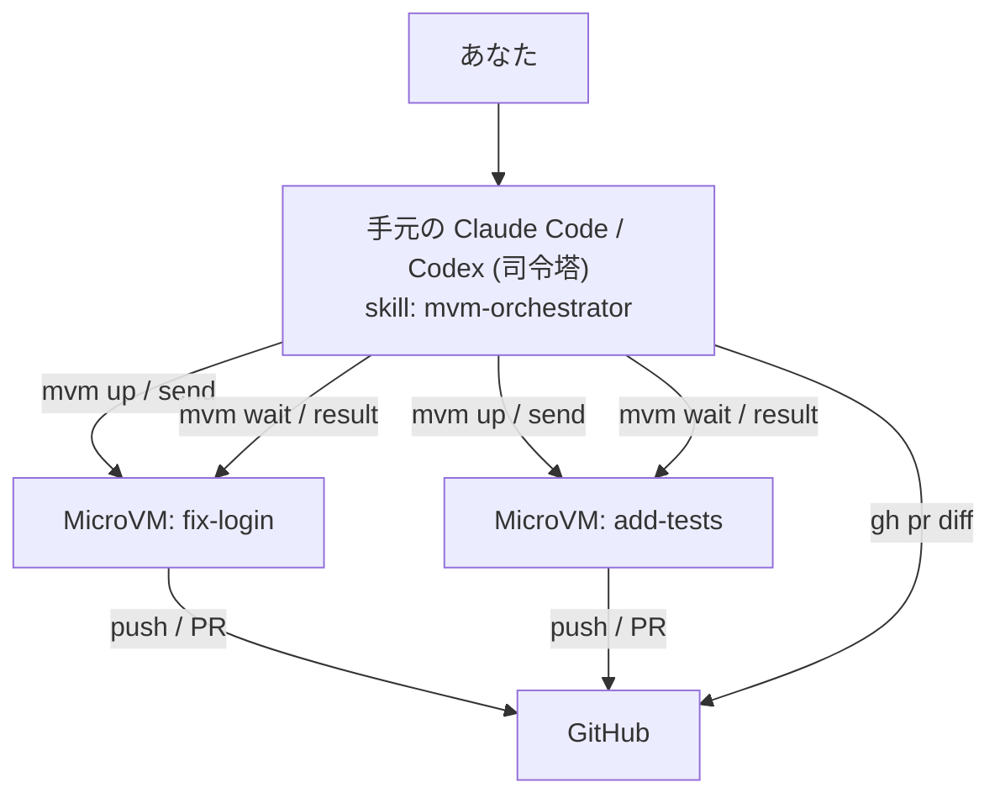

# 手元のエージェントを司令塔にする

手元の PC で動かす Claude Code / Codex に `mvm` の使い方を覚えさせ、重い作業を MicroVM のエージェントに任せる使い方です。

- **手元**: 司令塔のエージェントを 1 つだけ動かす。手元の skill、MCP、記憶、手元のファイル、社内ネットワークはそのまま使える。タスクを分け、指示を書き、終わるのを待ち、結果を確かめる
- **MicroVM**: 依存関係のインストール、ビルド、テスト、開発サーバー、ブラウザなど、Python / Node.js / Chrome が RAM を使う処理をすべて引き受ける

台数を増やしても、手元の RAM の使用量はほとんど変わりません。



## 準備

[quickstart.md](quickstart.md) を終えて、`mvm up` で 1 台動かせる状態にしておきます。そのうえで、司令塔にするエージェントに skill と設定を入れます。

```bash
mvm orchestrator install claude                     # Claude Code (すべてのフォルダで使える skill)
mvm orchestrator install claude --dir ~/control     # このフォルダで起動したときだけ。重い処理を止めるフックも入れる
mvm orchestrator install codex                      # Codex
mvm orchestrator install codex --dir ~/control
```

入れたあとで、エージェントを起動し直します。取り除くときは `install` を `uninstall` に変えて実行します (入れたものだけを消し、ほかの設定は残します)。

### 入るもの

| | Claude Code | Codex |
|---|---|---|
| skill (`mvm-orchestrator`) | `~/.claude/skills/` (`--dir` なら `<dir>/.claude/skills/`) | `~/.codex/skills/` (`--dir` なら `<dir>/.agents/skills/`) |
| 確認なしで実行できるコマンド | `mvm ls` / `peek` / `wait` / `result` / `follow` / `top` / `doctor` (`settings.json` の `permissions.allow`。`--dir` なら `settings.local.json`) | — (承認の方針は Codex の設定に従う) |
| 重い処理を止める仕組み | `--dir` のときだけ。`PreToolUse` フック (`scripts/orchestrator_guard.py`) が `npm` / `pytest` / ビルド / ブラウザなどを止め、「MicroVM に任せて」と返す | `--dir` のときだけ。`<dir>/AGENTS.md` に決まりを書き足す (強制はできない) |

- skill の中の `mvm` の呼び方は、このリポジトリの絶対パスになっています (エージェントのシェルではエイリアスが使えないため)。リポジトリを動かしたら `install` し直します
- VM を起動・終了する `mvm up` / `fleet` / `stop` は、これまでどおり毎回確認を求められます。skill にも「費用がかかる操作はユーザーの了承を得てから」と書いてあります
- 重い処理を止めるフックは、`--dir` で指定したフォルダだけに入れます。利用者全体に入れると、普段の作業でも `npm` などが止まってしまうためです。本当に手元で動かすときは、エージェントがあなたの了承を得てから、コマンドの先頭に `PMVA_ALLOW_LOCAL=1` を付けます

### Codex のサンドボックスで使うとき

Codex を `workspace-write` のサンドボックスで動かすと、既定ではネットワークと作業フォルダの外への書き込みができず、`mvm` が AWS に接続できません。`~/.codex/config.toml` に次を足します (`mvm orchestrator install codex` が、あなたの環境のパスで表示します)。

```toml
[sandbox_workspace_write]
network_access = true
writable_roots = ["<このリポジトリ>/.state", "<ホーム>/.aws"]
```

- `writable_roots` が無いと、`mvm` は「状態の保存先 … に書き込めません」と案内して止まります
- `network_access` が無いと、「接続できません」と案内して止まります
- `workspace-write` は `/tmp` にも書けます。`mvm` の状態の保存先 (`.state`) は既定でこのリポジトリの中なので、`writable_roots` に足す必要があります
- それでも動かない場合は、`--sandbox danger-full-access` で起動するか、`mvm` を実行するたびに承認してください

## 使い方

司令塔のエージェントに、ふだんの言葉で頼みます。

```text
このリポジトリの issue #12, #15, #18 を、MicroVM で並列に直して。それぞれ PR まで作って
```

エージェントは skill に従って、次のように進めます。

1. `mvm doctor` で同時に起動できる台数を確かめ、タスクの分け方と台数をあなたに提案する
2. 了承を得てから `mvm up` / `fleet` で起動する。指示には、終わりの状態 (テスト → commit → push → PR) と、必要な知識を書く
3. `mvm wait --timeout 540` で、終わるまで待つ (時間切れなら呼び直す)
4. `mvm result` で報告を読み、`gh pr diff` などで変更を確かめる。直してほしい点は `mvm send` で伝える
5. 結果をまとめて報告し、了承を得てから `mvm stop` で終える

許可を求められて止まった台 (`waiting`) があれば、エージェントが画面を確かめて答えるか、あなたに判断を求めます。

### 進み具合を自分で見る

司令塔のエージェントとは別のターミナルで、次のように実行します。

```bash
mvm follow            # 全台の推論の過程を流れるように表示
mvm view fix-login    # 1 台の画面を読み取り専用で表示
```

## うまく使うコツ

- **MicroVM 側のエージェントは手元を知らない**: 手元のファイルや会話の内容は、指示に書くか、リポジトリに置いて渡す必要があります。司令塔のエージェントは skill に従ってそうしますが、「方針は docs/design.md に書いてある」のように場所を教えると確実です
- **無人で進めるなら、作業側の許可を省く**: 作業側のエージェントを `--claude-args "--dangerously-skip-permissions"` などで起動すると、許可待ちで止まりません ([usage.md](usage.md#別々のタスクを並列に進める))
- **司令塔のコンテキストを節約する**: 画面の全文や会話の記録の全文は読ませず、`mvm result` と PR の差分で判断させます (skill にもそう書いてあります)
- **台数はクォータの範囲内**: `mvm doctor` の「同時に N 台まで」を超える起動は、1 台も起動せずに止まります

